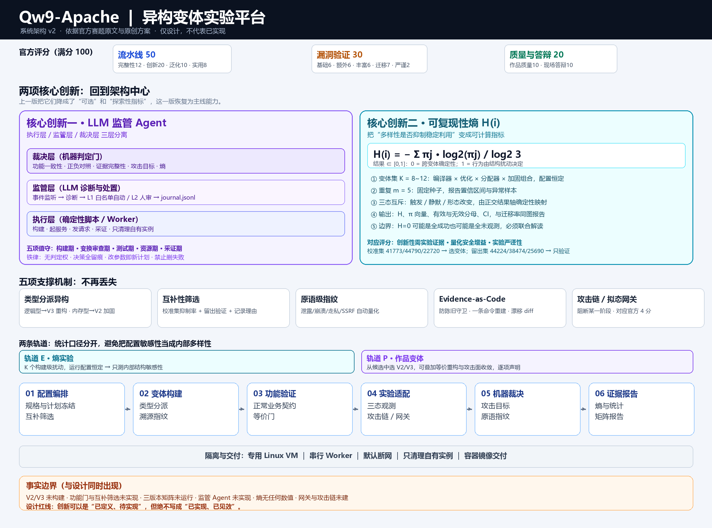
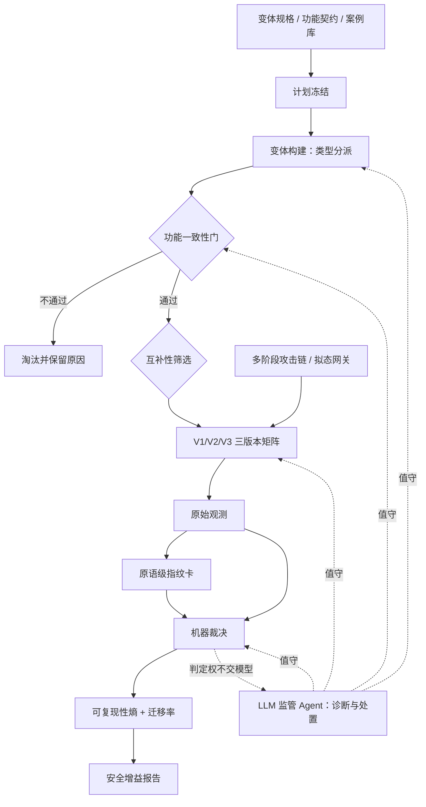

# Qw9-Apache 系统架构设计 v2

> **修订依据**：官方赛题原文（DOCX，SHA256 `54fd08abdb4908dae7a3f14216b6eb6bc5f85e4a36034e41925175195c03d95e`）、原始创新方案 Word v2 与 Markdown v3，以及确认口径：**两项核心创新＋保留原有支撑机制**。
> **交付范围：只做架构设计。** 本文的模块、接口、配置、命令均为拟建契约，不代表已实现。本次仅整理设计文档，未修改执行代码、未构建变体、未运行 PoC。
> 逐项核对见 [赛题要求·创新点·架构落点对照](赛题要求-创新点-架构落点.md)。

## 0. 这次改了什么

v1 把架构写成了通用实验框架，结果是：

- 没有逐条对照官方评分表，20 分的创新性和 4 分的攻击链加分被放在边缘；
- **核心创新一 LLM 监管 Agent** 被降级为"可选插件"；
- **核心创新二 可复现性熵** 被降级为"探索性指标、不能替代安全增益"；
- Word v2 里的**类型分派异构、原语级指纹、拟态网关/多阶段攻击链**直接丢失；
- **互补性筛选**没写，"为什么最终选这两个变体"没有答案。

v2 的修订原则只有一句：**创新点回到架构中心，事实边界留在证据层。** 创新可以处于"设计已定义、实现待完成"，但绝不能写成"已实现、已见效"。

---

## 1. 主线：两项核心创新，五项支撑机制

```text
                 ┌──────────────────────────────────────────┐
                 │  核心创新一：LLM 监管 Agent               │
                 │  执行层 / 监管层 / 裁决层 三层分离        │
                 │  构建·变换审查·测试·资源·采证 五项值守    │
                 └──────────────────────────────────────────┘
                                    ↕
   V1 ──类型分派异构──▶ V2/V3 ──功能一致性──▶ 互补筛选 ──▶ 三版本矩阵
                                    │
                 ┌──────────────────────────────────────────┐
                 │  核心创新二：可复现性熵 H(i)              │
                 │  K 个内部结构扰动 × m 次重复 × 三态分布   │
                 │  把"多样性是否抑制稳定利用"变成可算指标   │
                 └──────────────────────────────────────────┘
                                    ↓
        原语级指纹卡 · Evidence-as-Code · 多阶段攻击链 → 安全增益报告
```

| 层次 | 名称 | 回答的问题 | 对应评分 |
|---|---|---|---|
| 核心 | LLM 监管 Agent | 流水线失败时谁管、怎么管、如何可审计 | 创新性 20 分中"自动化编排" |
| 核心 | 可复现性熵 | 多样性到底有没有让攻击变得不稳定 | 创新性 + 量化安全增益 |
| 支撑 | 类型分派异构 | 为什么要用这两类变换、各自打什么漏洞 | 变换层次与方法组合 |
| 支撑 | 互补性筛选 | 为什么最终是这两个变体，而不是随便两个 | 两变体有效差异 |
| 支撑 | 原语级指纹 | 差异发生在哪一层、是否可外部观察 | 差异判定与可复核性 |
| 支撑 | Evidence-as-Code | 结论是否来自本轮新鲜证据 | 实验严谨性 2 分 |
| 支撑 | 拟态网关/多阶段链 | 攻击链在哪一步被阻断 | 迁移效果 7 分中的 4 分 |

---

## 2. 总体架构



### 2.1 逻辑视图



### 2.2 两条实验轨道（关键设计决策）

原始方案里有一个内部张力：V2 是"加固编译栈"，V3 是"等价重构＋配置收敛"；但熵实验又要求"运行配置恒定，避免测成配置敏感性"。v2 明确拆成两条轨道：

| 轨道 | 目的 | 变体集 | 配置 | 产物 |
|---|---|---|---|---|
| **轨道 E（熵）** | 测量"内部结构扰动"对漏洞可复现性的影响 | K=8~12 个构建级扰动（编译器×优化×分配器×加固） | **恒定** | 熵 H(i)、三态分布、置信区间 |
| **轨道 P（作品）** | 形成提交用的 V2/V3 两个变体 | 从轨道 E 候选中选优，可叠加等价重构与攻击面收敛 | 逐变体声明 | V2/V3 产物、指纹卡、矩阵 |

两条轨道共用构建与判据，但**统计口径分开**：熵只反映构建级多样性，配置收敛的效果单列为"配置敏感性"，不能混进熵里冒充内部结构多样性。这样既不丢熵的严谨性，也不丢 V3 的工程价值。

---

## 3. 核心创新一：LLM 监管 Agent

### 3.1 为什么需要它

自动化流水线的真实痛点不是"没脚本"，而是**脚本失败时没人管**：构建报错、依赖缺失、资源超限、日志撑盘、端口冲突、证据文件陈旧。这些恰好是评审现场最容易翻车的环节。项目里已经真实发生过：双 fuzzer 抢端口、日志爆盘、脚本用旧文件误判 PASS。

### 3.2 三层分离

```text
┌─────────────────────────────────────────────────────────┐
│ 裁决层（机器判定门）                                     │
│ 功能一致性 / 正负对照 / 证据完整性 / 攻击目标 / 熵计算    │
│ 只有这一层能给出 PASS、FAIL、INCONCLUSIVE                │
└──────────────────────────▲──────────────────────────────┘
                           │ 只读事实，不接受模型结论
┌──────────────────────────┴──────────────────────────────┐
│ 监管层（LLM 监管 Agent）                                 │
│ 事件监听 → 诊断 → 处置建议/白名单处置 → journal.jsonl    │
│ 无判定权；改参数需新计划 + 人审                           │
└──────────────────────────▲──────────────────────────────┘
                           │ 事件与脱敏日志
┌──────────────────────────┴──────────────────────────────┐
│ 执行层（确定性脚本 / Worker）                             │
│ 构建、起服务、发请求、采证、清理自有实例                   │
└─────────────────────────────────────────────────────────┘
```

### 3.3 五项值守职责

| 阶段 | 职责 | 处置级别 | 项目内真实案例 |
|---|---|---|---|
| 构建期 | 读编译错误，判断缺依赖/编译器不兼容/配置错误 | 装依赖=L1 自动；改参数/打兼容补丁=L2 待批 | nginx 1.13.2 在 gcc 11 下 `current_salt` 报错，靠兼容补丁解决 |
| 变换审查期 | 预审源码级重构 diff 是否偷改语义、顺手修洞、引入新行为 | L2：可疑 hunk 转差分测试，必须人审 | 44224 审计中识别出"任意 UDS"超出公告范围 |
| 测试期 | 功能一致性失败分类：崩溃/输出差异/配置错，决定重试、调参或淘汰 | 重试=L1；调参=L2；淘汰=记录后交裁决层 | fuzz 首版未命中，读源码修正生成结构后命中 |
| 资源期 | 看门狗：构建超时、内存峰值、日志撑盘、端口/进程冲突 | 杀自有超限进程、轮转日志、端口仲裁=L1 | 实测双 fuzzer 抢端口、日志爆盘 |
| 采证期 | 证据完整性审计：PASS 必须来自本轮、负向对照必须已跑 | 缺证回查=L1；判定打回=交裁决层 | 抓到并修复"旧文件误判 PASS" |

**L1（预授权白名单，可自动执行）**：安装缺失依赖、重启本轮自有服务、端口冲突仲裁、日志轮转、按预算终止自有进程、重新采集缺失证据。全部先存快照，动作写入 `journal.jsonl`，可回滚。

**L2（仅建议，人审后执行）**：改编译参数、打源码兼容补丁、改资源预算、改重试策略、改判据。执行后必须生成新计划哈希、重跑对照，保留首次失败。

**禁止**：改判定阈值、删失败样本、把 INCONCLUSIVE 改成 PASS、提权重试、访问授权范围外目标。

### 3.4 决策日志与可审计

每条监管事件至少记录：时间、阶段、触发事件、输入证据引用、诊断、建议动作、级别（L1/L2）、执行结果、回滚点、人工批准人（L2 必填）。日志只追加，不改写。审计时可回答："这次 PASS 之前，系统做过什么？"——这正是评审追问的点。

### 3.5 部署形态

- 监管进程与协调器同机，事件驱动，不常驻轮询日志文件；
- LLM 可用本机 GPUStack 部署的小模型（成本≈0），也可换外部 API；**API 凭据不进 Worker 实验环境**；
- 即使完全不接 LLM，流水线也必须能跑完——监管层只做增量，不是单点依赖；
- 日志、HTTP 响应、源码注释都是不可信输入，不得变成模型指令；提示注入防护属于设计验收项。

---

## 4. 核心创新二：可复现性熵

### 4.1 定义

对漏洞 i，取变体集 V={v₁…v_K}（同源码、不同内部结构扰动，**运行配置恒定**），攻击脚本在每个变体上独立重复 m 次，结果归入三个互斥类别，频率为 π₁、π₂、π₃：

```text
H(i) = − Σ_j π_j · log₂ π_j / log₂ 3        ∈ [0, 1]
```

- **H→0**：跨变体行为确定性——多样性对该漏洞天然无效；
- **H→1**：行为几乎完全由内部结构扰动决定——多样性天然抑制稳定利用。

### 4.2 三态为什么必须互斥

原始三态（触发/静默/形态改变）在语义上会重叠：一次"触发"也可能同时是"形态改变"。熵需要互斥类别，所以 v2 规定由正交结果轴**确定性映射**到熵类别：

| 熵类别 | 映射条件（全部满足） |
|---|---|
| **触发 T** | VALID 且攻击目标 GOAL_REACHED |
| **静默 S** | VALID 且根因路径 reached 且 GOAL_NOT_OBSERVED 且无可观察行为改变 |
| **形态改变 M** | VALID 且根因路径 reached 且 GOAL_NOT_OBSERVED 且存在可观察但非目标的改变（响应码/截断/异常信号等） |
| 不计入 | INVALID / INCONCLUSIVE / 根因不可达：单列分母，不塞进 π |

正交轴（有效性、攻击目标、表型标签）仍完整保留，熵只是它们的**汇总视图**，不是唯一判定。

### 4.3 实验设计

| 项 | 取值 | 说明 |
|---|---|---|
| 变体集 K | 8~12 | 编译器{gcc,clang}×优化{O0,O2}×分配器{ptmalloc,jemalloc}×加固{±FORTIFY} 的子集；可先做 8 个 |
| 重复 m | 5（探索性起点） | 固定种子；报告置信区间 |
| 规模 | 6 CVE × K × m ≈ 360 次 | 串行执行，单一 Worker 起步 |
| 划分 | 校准 41773/44790/22720；留出 44224/38474/25690 | 变体配对只用校准集，留出集只做最终验证 |
| 输出 | H(i)、π 向量、有效/无效分母、CI、异常样本 | 六漏洞熵对比图、熵 vs CWE 分布图 |

### 4.4 解释边界（不删创新，只标条件）

- **H=0 有两种含义**：全部攻击成功（多样性无效），或全部未观测（实验无效）。因此熵必须与 π 向量、攻击成功率、有效性分母同时报告，不能单看 H。
- **H 高可能是噪声**：小 K、小 m 下熵估计有偏，必须给置信区间并说明独立性假设。
- **熵 ≠ 安全增益本身，而是"稳定性被破坏"的量化信号**。安全增益的完整表述应是：攻击成功率、配对迁移率、攻击链中断点、原语差异、功能等价与开销共同支撑，熵是其中"多样性是否制造不确定性"的那一维。
- 这样写既保住创新点，也不会在答辩时被一句"H 高就是安全吗"问倒。

### 4.5 与评分的对接

- 直接支撑"量化安全增益"与"创新性需有实验证据支持"；
- 熵分布 + 迁移率 + 指纹卡三者同图呈现，是答辩的可视化主图；
- 校准/留出划分体现实验纪律，是多数队伍没有的加分项。

---

## 5. 五项支撑机制（原方案中的独立创新点）

这五项在 Word v2 里分别是创新点一（类型分派）、创新点二（拟态网关）、创新点三（原语指纹）、创新点四（Evidence-as-Code），互补性筛选则来自 Markdown v3。v2 把它们挂在两项核心创新之下，**不是降级，而是分层**：

- 答辩时，核心创新回答"方法原理与量化模型是什么"；
- 支撑机制回答"这些原理怎么落到构造、筛选、观测、采证和攻击链上"；
- 两者合起来才是评委要的"多方法融合创新＋实验证据"。

### 5.1 类型分派异构（Type-Aware Diversification）

依据 11 个 CVE 的敏感性差异分派变换手段，而不是随机选两个编译参数：

| 漏洞类型 | 实例 | 对编译器/分配器 | 对等价重构 | 对配置收敛 | 分派结论 |
|---|---|---|---|---|---|
| 逻辑型（穿越/走私/SSRF） | 41773、44224、22720、25690 | 不敏感 | 敏感 | 敏感 | 交给 V3 的等价重构与收敛 |
| 内存型（越界/下溢/未初始化） | 44790、22719、23943 | 敏感 | 部分敏感 | 不适用 | 交给 V2 的加固编译栈 |

- V2：clang + FORTIFY + 分配器替换，制造"崩溃 vs 静默 vs 泄露"漂移；
- V3：语义等价重构 + 攻击面收敛，使逻辑型触发失效；
- 该表是设计依据，**不是效果承诺**；实际效果由轨道 P 的三版本矩阵验证。

### 5.2 互补性筛选

不是"随便生成两个变体"，而是：

1. 在校准集上，对每个候选变体计算攻击抑制率；
2. 选择一对 (v_a, v_b)，使**联合成功概率最小**（互补性最大），同时两者都通过功能一致性门；
3. 用留出集做最终验证，防止过拟合；
4. 记录筛选过程与理由——评委一定会问"为什么是这两个"。

### 5.3 原语级差异指纹

每个"漏洞 × 变体"输出一张可复核的指纹卡：

| 维度 | 量化字段 |
|---|---|
| 信息泄露 | 泄露字节数、内容类别、命中特征串 |
| 内存破坏 | 崩溃信号、ASAN 错误类型与偏移、core 是否产生 |
| 请求走私 | 后端收到请求行数、注入头是否出现 |
| SSRF | 可达端点、返回内容标记 |
| 控制流/最终目标 | 是否执行、执行用户、是否触达目标资源 |

指纹由 oracle 自动生成，不允许人工填表。赛题要求"差异到利用原语粒度"，指纹卡直接对齐 P029。

### 5.4 Evidence-as-Code

- 每个 verify 的退出码即结论，报告结论绑定机器断言；
- **防陈旧证据守卫**：二进制缺失即失败；旧证据先归档再跑；PASS 必须来自本轮 run_id；
- 负向对照内建：每次判定自带阳性（漏洞版必中）与阴性（修复版必不中）；
- 一条命令重建全部证据，并输出结论漂移 diff。

这条机制来自项目里真实踩过的坑，答辩时是"我们吃过亏并固化"的加分叙事。

### 5.5 拟态网关与多阶段攻击链

官方 P017 明确把"运行时选择、隔离策略"列为攻击链多样化手段，P035 为多阶段攻击链额外给分（最高 4 分）。设计：

```text
请求 → 按种子轮换 → 网关 → V1/V2/V3 之一
                          ↓
              响应归一化（抹除 Date/Server 等）
                          ↓
              三变体比对 / 表决 → 异常响应丢弃
```

链式测试示例（无害化）：路径穿越读配置 → 用泄露信息模拟下一步 → 观察在哪一阶段被阻断。核心结论是"阻塞链中某一特定阶段，而非全部阶段"，正好对应"漏洞仍存在但利用受抑制"。

边界必须写清：网关是部署层增强，**不改变单变体漏洞存在性**；它能拦住的只是"经网关的那条路径"，不能宣称系统绝对安全。

---

## 6. 六个核心模块 ＋ 一个监管层

| 模块 | 职责 | 主要承载 | 不负责 |
|---|---|---|---|
| M1 配置与编排 | 规格校验、计划冻结、依赖、状态机、互补筛选 | 双方言规格、校准/留出、计划哈希 | 判定漏洞 |
| M2 变体构建 | 类型分派、构建、指纹、溯源 | 轨道 E/P 的产物 | 安全结论 |
| M3 功能验证 | 正常业务契约、等价门 | 静态/CGI/Lua/代理/重写/连接 | 攻击结论 |
| M4 实验适配 | 起实例、发请求、采证、攻击链、网关 | 三态观测、链式观测 | PASS/FAIL |
| M5 机器裁决 | 功能比较、攻击目标、指纹生成 | FingerprintCard、负向对照 | 改证据 |
| M6 证据与报告 | 封存、清单、熵计算、矩阵、报告 | 完整分母、CI、漂移 diff | 重判 |
| **M7 监管层（横切）** | 事件监听、诊断、L1/L2 处置、journal | LLM 监管 Agent | **判定、改阈值、删失败** |

依赖方向：`M1 → M2/M3/M4 → M5 → M6`；M7 横向监听所有阶段，只能调用预授权处置工具，不能写入 Judgment。

领域层不依赖 Shell/具体 VM/LLM SDK；所有真实进程操作经 Worker 执行边界；裁决不启动进程；报告不回改观测。

---

## 7. 数据契约

十三类核心数据，统一 `schema_version`、稳定 ID、内容哈希引用：

| 契约 | 关键字段 | 约束 |
|---|---|---|
| ExperimentSpec | 版本、源码、变体、案例、契约、预算、次数、种子 | 冻结后改即新哈希 |
| VariantSpec | role、readiness、源码 SHA、配方、工具链、补丁、配置 SHA、轨道 | BASELINE/CANDIDATE/CONTROL 分开；DRAFT 不可执行 |
| BuildArtifact | 源码/工具链/参数指纹、二进制与模块哈希、安装树引用 | 真实构建才产生 |
| CaseSpec | case_id、root_cause_id、attack_goal、适配器、输入模板、oracle 版本、限额 | 根因去重；判据预注册 |
| ChainSpec | 阶段序列、阶段判据、无害化载荷、阻断点定义 | 每阶段可独立观测 |
| ExperimentPlan | run_id、commit、三版本、案例集、重复、顺序、预算、fail policy、plan_hash | 人审后冻结 |
| TaskRequest | 适配器、输入引用、variant/replicate/attempt、租约、超时、资源策略 | 只接受类型化参数，不接受任意 shell |
| Observation | 阶段、状态、退出/信号、资源、原始响应/后端事实、artifact 引用 | 不含主观 PASS |
| FingerprintCard | 漏洞 × 变体、各原语维度量化值、证据引用 | 由 oracle 生成，非人工填表 |
| Judgment | validity、goal_outcome、phenotypes、entropy_class、reasons、oracle 版本、证据引用 | 无效不得记收益 |
| SupervisorJournalEntry | 时间、阶段、事件、诊断、动作级别、回滚点、批准人 | 只追加；L2 必有人 |
| EvidenceManifest | 相对路径、SHA256、大小、生产者、run_id、输入/构建/计划引用 | 拒绝逃逸路径与跨轮旧文件 |
| EntropyReport | CVE、K、m、π 向量、H、CI、有效/无效分母、异常样本 | 无有效数据不得出熵 |

结果仍用正交轴：

- 有效性：VALID / INVALID / NOT_RUN（附超时、资源不足、对照失败等原因）；
- 攻击目标：GOAL_REACHED / GOAL_NOT_OBSERVED / INCONCLUSIVE；
- 表型标签：crash、response_changed、backend_effect、sanitizer_signal 等，可多选；
- 熵类别：由上述映射得到，仅供 H 计算。

超时、OOM、启动失败默认 INVALID/INCONCLUSIVE，**不计防御成功**。DoS 需独立探针与资源诊断满足预注册判据。

---

## 8. 生命周期与门禁

```text
DRAFT → VALIDATED → PLANNED → APPROVED
      → BUILDING → FUNCTIONAL_CHECK → COMPLEMENTARITY_SCREEN
      → CONTROL_CHECK → EXPERIMENTING → SEALING → REPORTED

任一阶段可结束为 BLOCKED / FAILED / CANCELLED
执行另记 TIMEOUT / RESOURCE_LIMITED / START_FAILED
```

| 门 | 检查 | 失败处理 |
|---|---|---|
| G0 规格冻结 | 版本、契约、载荷、判据、预算、次数、停止规则 | 不生成可执行计划 |
| G1 环境与所有权 | 作用域、真实路径、无宿主可写挂载、端口、实例归属、资源 | 拒绝启动 |
| G2 功能一致性 | V1 与候选满足同一正常业务契约 | 候选退出收益比较 |
| G3 本轮校准 | V1 阳性、适用修复版阴性、功能仍正常 | 暂停该场景比较 |
| G4 互补性 | 校准集上配对抑制率、留出集不复用 | 不进入作品变体 |
| G5 证据完整性 | 本轮实例/输入/规则关联、原件齐全、退出原因明确 | 不确定，保留缺失 |
| G6 机器判据 | 规则支持攻击目标、指纹与熵类别 | 无证据不下结论 |

G1 是执行阻断项，不是后期优化。旧脚本写死宿主路径、可能全局清理进程，未完成参数化与实例所有权校验前，不允许新平台直接调用。

对照与配对：每块固定输入，先验证 V1 阳性与适用阴性，再比较多变体；版本顺序按种子平衡；跨实例重置状态；重试与重复分开编号；改任何参数即新批次并重跑对照。

---

## 9. 部署与技术选型

| 领域 | 建议 | 说明 |
|---|---|---|
| 控制与业务 | Python 3.11+，模块化单体 CLI | 不先上微服务 |
| 规格/契约 | 安全 YAML + Pydantic 2 + 版本化 JSON | 禁任意代码与命令插值 |
| 执行 | 参数数组、显式 cwd/env、进程组租约、超时 | 禁任意 shell、禁全局 pkill |
| 正常 HTTP | 标准客户端 | 只用于功能契约 |
| 特殊原始输入 | 审查过的场景适配器 | 防止库规范化攻击关键字节 |
| 证据 | 文件系统 + JSON/JSONL + SHA256 | 事实源；可归档 |
| 索引 | SQLite（后续可选） | 单写、可重建 |
| 熵与统计 | Python + numpy/pandas | 只读封存数据 |
| 监管层 | 事件循环 + 本机 GPUStack 小模型/外部 API | 可拔插；无判定权 |
| 隔离 | 专用可回滚 Linux VM；容器可选 | 明确 daemon 宿主；WSL1 历史不混用 |
| 交付 | 容器镜像 + compose | 对应泛化与实用性加分 |

未来工程布局（未创建）：

```text
platform/
  pyproject.toml
  src/qw9/
    domain/        类型、状态、规则、端口契约
    application/   计划、门控、互补筛选、编排
    adapters/      构建、功能、场景、oracle、指纹
    supervisor/    事件、诊断、L1/L2 处置、journal
    infra/         文件、进程、索引
    cli.py
  configs/         变体、契约、案例、策略
  tests/           单元、契约、故障、回放
```

真实工件在 VM 外置工作根，不堆进 `platform/`。

---

## 10. 四人切面与里程碑

### 10.1 切面（待认领，不代表已邀请）

| 角色 | 主责 | 不做什么 |
|---|---|---|
| 负责人 | 领域契约、编排、互补筛选、**监管 Agent 架构**、集成验收 | 不替代 oracle 写判据 |
| 共创者 A / 漏洞与熵 | 案例库、根因去重、三态映射、**熵实验设计**、统计口径 | 不改 Worker 与构建器 |
| 共创者 B / 变体与构建 | 类型分派配方、V2/V3 构建、功能契约取证、开销测量 | 不自行弱化功能判据 |
| 共创者 C / 工程与证据 | Worker、证据封存、指纹卡渲染、报告、容器交付 | 不改安全语义裁决 |

### 10.2 里程碑（按评分表优先级排）

| 里程碑 | 交付 | 对应评分 | 通过条件 |
|---|---|---|---|
| M0 契约冻结 | 规格、契约、案例库、结果字典、作用域 | 完整性 12 的基础 | 无旧路径直通，无歧义状态 |
| M1 离线闭环 | schema、计划 dry-run、模拟适配器、证据封存 | 严谨性 2 | 不启动真实目标也能验证状态与失败保留 |
| M2 V1 + 监管 MVP | 隔离 VM、首个真实场景、五项值守最小实现、journal | 创新性（编排） | 归属明确、证据新鲜、旧环境未被访问 |
| M3 V2/V3 + 功能门 + 互补筛选 | 两个变体真实构建、功能一致性、配对筛选 | 完整性 12 + 创新 20 | 功能等价通过，筛选有记录 |
| M4 三版本矩阵 + 指纹 + 攻击链 | 6 CVE × 3 变体、指纹卡、链式测试、拟态网关原型 | 漏洞 30 中的 6+6+6+4 | 同输入重复、对照有效、差异可复核 |
| M5 熵 + 量化 | K×m 实验、H、CI、迁移率、开销 | 创新 20 + 迁移 3 | 完整分母，未知不计成功 |
| M6 泛化 + 容器 | 迁移实例、镜像交付、一键复现 | 泛化 10 + 实用 8 | 评审环境可重建 |

### 10.3 评分策略建议

- 前 3 个有效漏洞（6 分）优先用差异最稳的 41773 / 44224 / 44790；
- 额外漏洞每 2 分、最高 6 分，需要 **6 个有效漏洞**，候选 22720 / 25690 / 38474 / 37436 / 27522；
- 类型丰富度 ≥3 类即可拿高分，现有覆盖足够，重点是"在 V2/V3 上真的出现差异"；
- 攻击链是 4 分档，必须单独设计至少一条链并展示"阻断在某一阶段"；
- 容器镜像是泛化/实用性的明确加分项，别拖到最后。

---

## 11. 事实边界（必须与设计同时出现）

| 项 | 状态 |
|---|---|
| V1（Apache httpd 2.4.49）历史实验 | 已有 10 动态复现、1 静态定位（23943），本次未复跑 |
| V2 / V3 真实构建 | **未完成** |
| 功能一致性门 | **未实现** |
| 互补性筛选 | **未实现** |
| 三版本矩阵 | **未实现** |
| 原语指纹卡 | **未实现**（历史证据可作输入） |
| LLM 监管 Agent | **未实现**，仅有设计 |
| 可复现性熵实验 | **未运行**，无任何 H 数值 |
| 拟态网关 / 多阶段攻击链 | **未实现** |
| 容器镜像交付 | **未实现** |
| 现有脚本可直接复现 | **否**，仍绑定原实验机路径 |

任何"已提升安全""抑制率 X%""熵为 Y"的表述，在 M5 完成前都不得出现。

---

## 12. 设计验收红线

1. 仍会访问原宿主工作区、宽匹配清理他人进程的入口，拒绝接入；
2. 功能不等价仍计入安全收益，拒绝；
3. 读旧 PASS 当本轮证据、删除失败分母，拒绝；
4. LLM 改判据、改阈值、删失败、把 UNKNOWN 改 PASS，拒绝；
5. 只有哈希/地址差异就宣称有效异构，拒绝；
6. V2/V3 未构建就宣称安全增益，拒绝。

---

## 附录 A：v1 → v2 修订对照

| 项 | v1 | v2 |
|---|---|---|
| LLM 监管 | "可选插件，只提建议" | **核心创新一**，常驻 M7，三层分离，五项值守，L1/L2 处置 |
| 可复现性熵 | "探索性指标，不能替代安全增益" | **核心创新二**，完整定义、三态互斥映射、K×m 实验、CI、与评分对接 |
| 类型分派异构 | "候选实验变量" | 支撑机制，按漏洞类型分派 V2/V3，附敏感性表 |
| 互补性筛选 | 无 | 支撑机制，校准集抑制率 + 留出验证 + 记录理由 |
| 原语级指纹 | 无 | 支撑机制，FingerprintCard，oracle 自动生成 |
| Evidence-as-Code | 部分（证据新鲜性） | 独立支撑机制，防陈旧守卫 + 一条命令重建 + 漂移 diff |
| 拟态网关/攻击链 | 无 | 支撑机制，对应官方 4 分加分 |
| 官方评分表 | 未逐条对照 | 单独对照表，逐项落点与现状 |
| 事实边界 | 有 | 保留，集中在第 11 节 |

## 附录 B：依据文件

本设计在参赛工作区中直接读取了以下原件。官方赛题与原始方案文档不在本仓库内，此处只登记身份信息，便于复核时比对：

| 文件 | 说明 | SHA256 |
|---|---|---|
| 官方赛题 `qw9-design-challenge-zh.docx` | 第九届强网拟态设计安全大赛赛题 | `54fd08abdb4908dae7a3f14216b6eb6bc5f85e4a36034e41925175195c03d95e` |
| 原始创新方案 Word v2 | 五项创新点版本（类型分派/网关/指纹/证据链/LLM 监管） | `63ab8758a595650292cee40046e66ea31a4891a9977d2cb3f81529e5d46c9b59` |
| 原始创新方案 Markdown v3 | 收敛为两项核心创新＋熵实验设计 | 以工作区版本为准 |

逐项对照见 [赛题要求-创新点-架构落点.md](赛题要求-创新点-架构落点.md)。需求引文是摘录性质，用于说明架构落点，不替代赛题原文。
